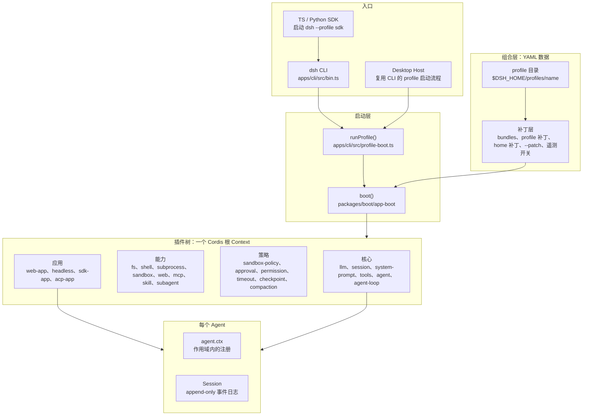
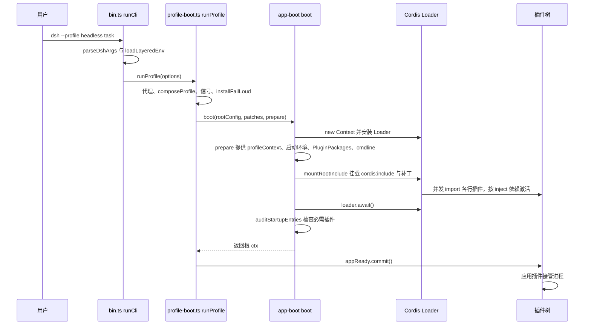
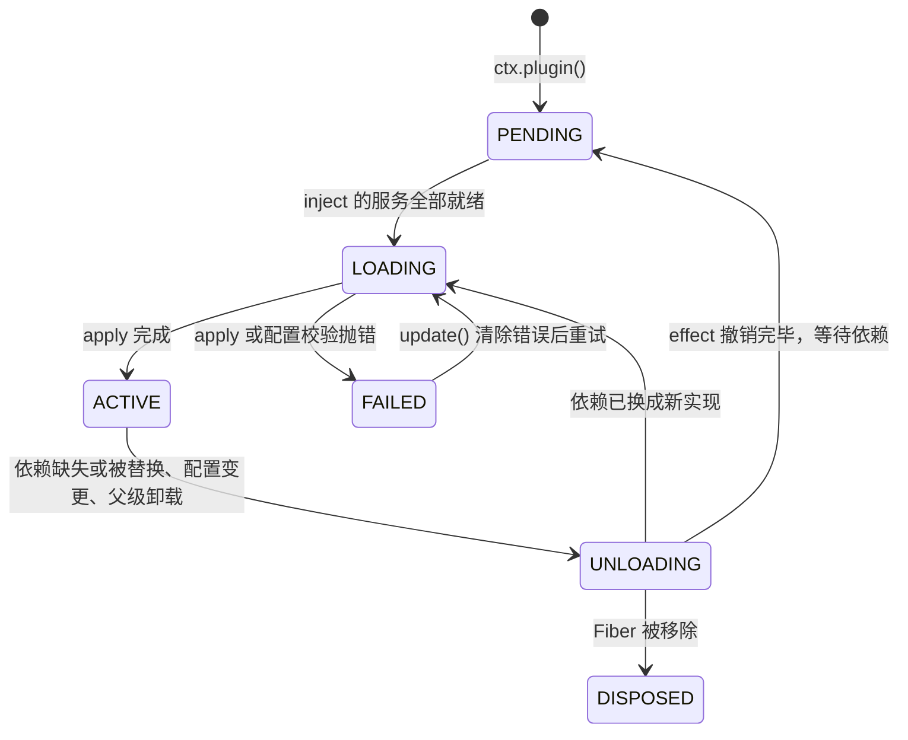
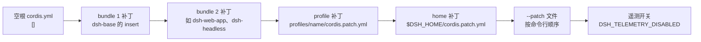
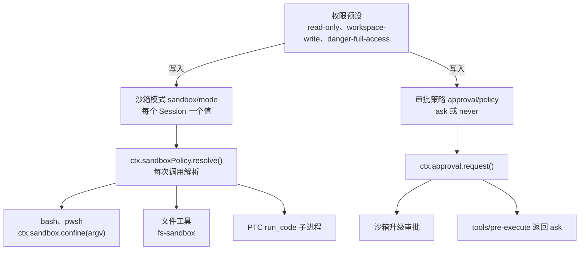
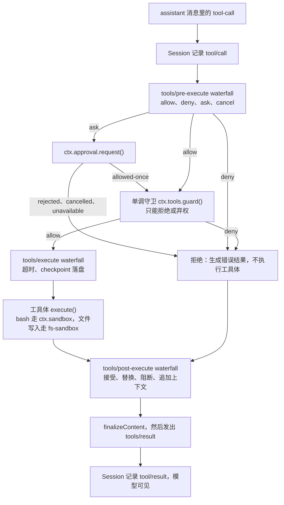
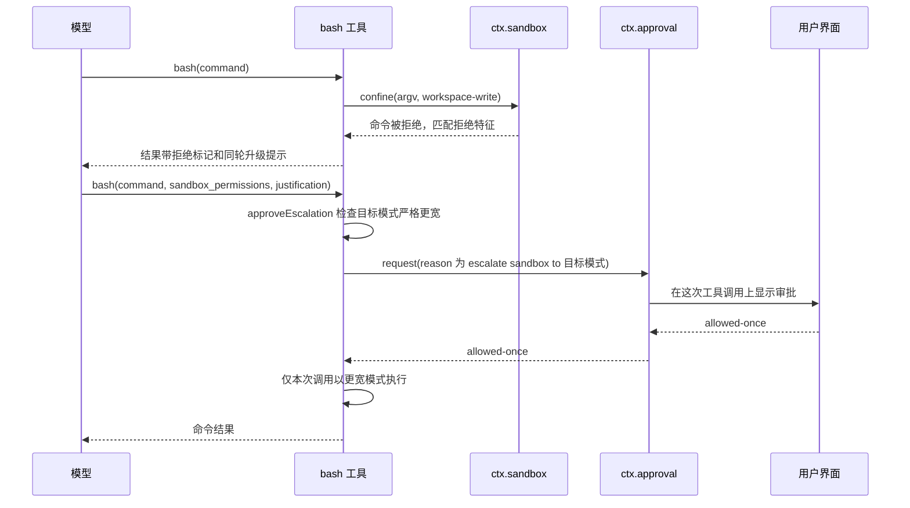
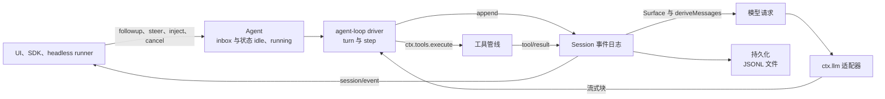
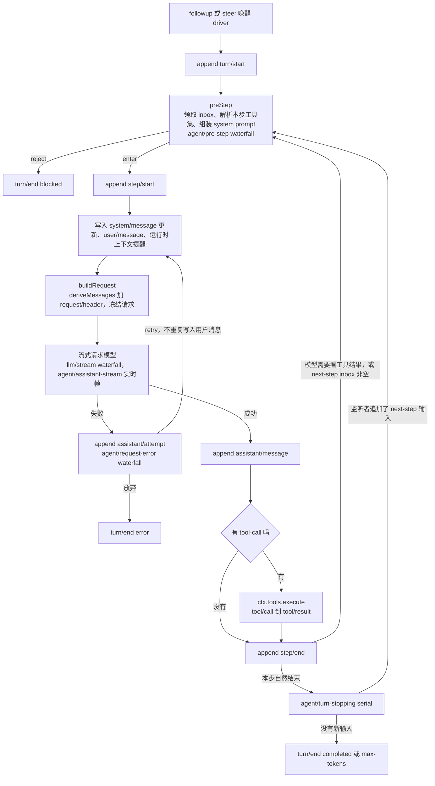

# DeepSeek Harness 架构学习笔记

> 基于本仓库 `@deepseek-ai/dsh` `0.2.3-alpha.2` 的源码，2026-11-24 整理。本文是学习笔记：每个结论都附有源码或文档链接，行号会随代码演进漂移；内容冲突时以源码和 [docs/architecture.md](../docs/architecture.md) 为准。
>
> 配套演示文稿：[architecture.html](architecture.html)（63 页、41 张图表；在仓库目录里用浏览器打开，← → 翻页，T 打开目录）。

## 目录

- [0. 全景](#0-全景)
- [1. 启动：从 `dsh` 命令到运行中的插件树](#1-启动从-dsh-命令到运行中的插件树)
- [2. 插件加载：Cordis、Loader 与 Profile 分层](#2-插件加载cordisloader-与-profile-分层)
- [3. 权限控制：沙箱、审批与预设](#3-权限控制沙箱审批与预设)
- [4. 对话控制与管理：Agent、Session 与 Agent Loop](#4-对话控制与管理agentsession-与-agent-loop)
- [5. 其他设计巧思](#5-其他设计巧思)
- [6. 推荐阅读路线](#6-推荐阅读路线)
- [附：本文的验证记录](#附本文的验证记录)

-----

## 0. 全景

DeepSeek Harness（命令名 `dsh`）是一个“全插件”的 coding agent 运行时。模型适配器、工具注册表、会话日志、权限策略，甚至驱动对话的 agent loop 本身，都是 [Cordis](../docs/cordis-primer.md) 插件。启动时，*profile* 把若干 *bundle* 携带的 YAML 补丁层叠成一棵插件树；随后由树里的“应用插件”（Web 服务器、headless 一次性执行器、SDK 或 ACP 服务器）接管进程。



读代码时抓住三条主线：

1. **组合**：进程里运行哪些插件，完全由 YAML 补丁层决定（第 1、2 节）。
2. **事件**：插件之间通过类型化事件协作，权限与策略作为 waterfall 事件的监听者插入（第 2、3 节）。
3. **日志**：对话的唯一事实来源是 append-only 的 Session 事件日志，模型看到的历史全部从日志派生（第 4 节）。

### 仓库地图

| 目录 | 内容 |
|---|---|
| [apps/cli](../apps/cli/README.md) | `dsh` 命令行启动器，第 1 节的起点 |
| `apps/web`、`apps/desktop*` | Web 应用资源与 Electron 桌面端 |
| [packages/](../packages/README.md) | 按 `packages/<group>/<pkg>` 分组的 `@deepseek-ai/dsh-*` 包；pnpm workspace 共 422 个项目 |
| [packages/bundle/](../packages/bundle/README.md) | 6 个 bundle：`base`、`web-app`、`headless`、`sdk-app`、`acp-app`、`sdk-minimal` |
| [vendor/](../vendor/README.md) | vendored 的 Cordis 框架：`cordis`、`loader`、`include`、`hmr`、`group`、`schemastery` 等 |
| [docs/](../docs/architecture.md) | 官方架构文档、[子系统参考](../docs/subsystems/README.md)、cookbook |
| [scripts/](../scripts/AGENTS.md) | 构建、生成器与 52 个 `verify-*` 校验脚本 |
| `.agents/notes/` | Agent Notes：设计决策记录 |
| `python/`、`native/` | Python SDK 与原生插件 |

### 术语表

| 术语 | 含义 | 代码 |
|---|---|---|
| Context（`ctx`） | Cordis 的服务容器，本身是一个 Proxy；读取 `ctx.tools`、`ctx.sessions` 会解析到对应服务 | [context.ts](../vendor/cordis/src/context.ts#L42) |
| 插件（Plugin） | 导出 `apply(ctx, config)` 的模块，或一个 `Service` 子类；可声明 `inject` 依赖和 `Config` 校验 | [timeout-policy](../packages/guard/timeout-policy/src/index.ts#L55) |
| 服务（Service） | 在 Context 上占用一个 key 的对象；其他插件按 key 使用它，不 import 具体实现 | [service.ts](../vendor/cordis/src/service.ts#L12) |
| Fiber | 一次插件应用的运行时实例，管理状态、依赖、配置与 effect 清理 | [fiber.ts](../vendor/cordis/src/fiber.ts#L214) |
| Effect | 可撤销的注册：注册时得到 disposer，插件卸载时按逆序执行 | [fiber.ts](../vendor/cordis/src/fiber.ts#L104) |
| Entry（配置行） | `cordis.yml` 中的一行：`id`、`name`、`config`、`disabled`、`inject` | [entry.ts](../vendor/loader/src/config/entry.ts#L10) |
| Bundle | 在 `package.json` 声明 `dsh.bundle.patch` 的 npm 包，携带一组补丁行 | [dsh-base 补丁](../packages/bundle/base/cordis.patch.yml) |
| Profile | `$DSH_HOME/profiles/<name>` 目录：有序 bundle 列表、用户补丁和外部插件依赖 | [profile.ts](../packages/boot/app-boot/src/profile.ts#L728) |
| Agent | 运行中的对话驱动者句柄：inbox、状态、取消 | [runtime-types.ts](../packages/core/agent/src/runtime-types.ts#L191) |
| Session | append-only 事件日志，对话的唯一事实来源 | [Session](../packages/core/session/src/index.ts#L304) |
| Turn / Step | Step 是一次模型请求加上它调用的工具；Turn 在领取第一条输入之前打开，到没有待办时关闭，包含零个或多个 Step | [agent.ts](../packages/core/agent-loop/src/agent.ts#L323) |
| Surface | 日志中会产生模型消息的事件，按模型可见顺序排成的投影 | [SurfaceOp](../packages/core/session/src/types.ts#L477) |
| Seam（能力接缝） | 一项可替换能力的三个角色：Service Definition、Service Provider、Consumer | [capability-seams.md](../docs/capability-seams.md) |

-----

## 1. 启动：从 `dsh` 命令到运行中的插件树

一句话概括：[`bin.ts`](../apps/cli/src/bin.ts) 解析参数，`runProfile()` 读取 profile 并计算补丁层，`boot()` 创建根 `Context`、安装 Loader、挂载根 Include；Loader 并发导入并按服务依赖激活所有插件行；启动审计通过后，应用插件接管进程。

### 1.1 入口在哪里

| 启动方式 | 实际执行的代码 | 说明 |
|---|---|---|
| 源码运行 `pnpm dsh …` | `node --import tsx/esm apps/cli/src/bin.ts` | 根 [package.json](../package.json#L222) 的脚本；源码启动只经过 tsx 的 ESM hook |
| 安装后的 `dsh` | `@deepseek-ai/dsh` 包的 `bin.dsh`，即 `lib/bin.js` | 由 `src/bin.ts` 构建，见 [apps/cli/package.json](../apps/cli/package.json) |
| Desktop 与嵌入式运行时 | [installed-bin.ts](../apps/cli/src/installed-bin.ts) 导出的 `runCli(options)` | 可注入打包的 pnpm，并允许管理保留的 `desktop` profile |
| `pnpm run start:web`、`pnpm run dev:web` | `bin.ts web`；`dev:web` 先构建产物再启动，并在改动时重建客户端 | Web 开发 |
| TS SDK、Python SDK | 启动子进程 `dsh --profile sdk` | SDK 只选择 profile 和补丁文件，不直接挂载插件 |

仓库规定：受支持的 Node 应用只能通过具名 `dsh` profile 启动，包 bin、demo 和 SDK 都不能绕过它；[verify-application-entrypoints.ts](../scripts/verify-application-entrypoints.ts) 把这条规则做成了门禁。

### 1.2 `runCli()`：解析参数并分派模式

[`runCli()`](../apps/cli/src/bin.ts#L26) 只做三件事：

1. **解析参数**：[`parseDshArgs()`](../apps/cli/src/args.ts#L146) 基于 commander，只认启动器自己的参数（`--profile`、`--patch`、`--dump-config`、`--dump-default-config`、`--dump-config-schema`、`--from-default-profile`）。遇到第一个不认识的 token 后，剩余参数原样交给被启动的应用，所以 `dsh --profile headless --help` 打印的是 headless 应用自己的帮助。`dsh <name>` 是 `dsh --profile <name>` 的简写。
2. **按模式分派**：`profile`（启动插件树）、`plugin`（在 profile 目录里转发给 pnpm）、`dump-config`（只打印组合结果）、`dump-config-schema`（打印插件配置 schema）。每种模式用动态 `import()` 加载自己的模块；`switch` 的 `default` 分支写 `invocation satisfies never`，新增模式未处理时编译失败。
3. **准备环境快照**：profile 模式先调用 [`loadLayeredEnv('dsh')`](../packages/boot/app-boot/src/index.ts#L259)，生成本次运行冻结的环境变量快照。优先级为继承的环境变量 > 当前目录 `.env` > `$DSH_HOME/.env`；低层只补充缺失值，不覆盖继承值。启动失败抛出的 `StartupError` 由 `reportStartupFailure()` 打印诊断，进程以退出码 1 结束。

### 1.3 `runProfile()`：准备 profile 与进程级设施

[`runProfile()`](../apps/cli/src/profile-boot.ts#L279) 是所有 profile（web、headless、sdk、acp、desktop）共用的启动流程：

1. 设置 `DSH_USER_AGENT_SUFFIX=dsh-profile/<name>`，模型服务商可以看到请求来自哪个 profile。
2. 调用 `installProxyFromEnvironment()`。Node 的 `fetch` 默认不读取代理环境变量；这里从启动快照（而不是 `process.env`）安装代理，所以写在 `.env` 层里的代理同样生效。
3. [`composeProfile()`](../apps/cli/src/profile-boot.ts#L222) 调用 [`prepareProfile()`](../apps/cli/src/profile-boot.ts#L192) 和 [`loadProfile()`](../packages/boot/app-boot/src/profile.ts#L728)：
   - profile 目录是 `$DSH_HOME/profiles/<name>`。`$DSH_HOME` 默认是 `~/.dsh`（[`DSH_HOME_DIR_NAME`](../packages/util/home-paths/src/index.ts#L12)），可用环境变量 `DSH_HOME` 覆盖。
   - 目录不存在时：如果名字是内置模板（[`PROFILE_TEMPLATES`](../packages/util/official-bundles/src/bundles.ts#L10)：`web`、`headless`、`sdk`、`acp` 都是 `dsh-base` 加各自的模式 bundle，`sdk-minimal` 只有自己一个 bundle），就用 [`initProfile()`](../packages/boot/app-boot/src/profile.ts#L198) 自动初始化；否则报错，并提示用 `dsh plugin --profile <name> add <package>` 创建。
   - [`loadProfileDirectory()`](../packages/boot/app-boot/src/profile.ts#L678) 逐个解析 bundle：定位包目录，读取 `dsh.bundle.patch`，检查平台与版本兼容性。失败的 bundle 记入 `skippedBundles` 并打印警告，不中断启动。
   - 每次启动都把根 `cordis.yml` 重写为空列表 `[]`（[`PROFILE_ROOT_CONFIG`](../apps/cli/src/profile-boot.ts#L79)）。原因是 Loader 能把当前树写回配置文件；如果不重写，组合后的行会被写进根文件，下次启动时每个 bundle 的 insert 就会重复一遍。
   - `createRuntimeResolution()` 在任何插件被 import 之前，算出本次启动不可变的包解析表（见 [2.5](#25-插件包从哪里解析)）。
4. 安装信号处理（[profile-boot.ts#L317](../apps/cli/src/profile-boot.ts#L317)）：`SIGTERM` 以 0 退出，`SIGINT` 以 130 退出。信号处理在 `boot()` 结束前就已安装，因为某个 provider 可能在兄弟插件挂载完成前就已对外提供服务。[`createProcessShutdown()`](../apps/cli/src/process-shutdown.ts#L22) 给整棵树的销毁设置宽限时间，重复收到信号时升级为强制退出。
5. [`installFailLoud()`](../packages/boot/app-boot/src/index.ts#L901)：`unhandledRejection` 和 `uncaughtException` 一律按致命错误处理。它先写诊断，再在 2 秒上限内销毁插件树（让占用终端的应用恢复终端状态），然后退出。
6. 组装 `ProfileContext`（profile 名、目录、补丁路径、安装锚点、本次启动的 bundle、cwd、home、`--patch` 文件、`DSH_TELEMETRY_DISABLED`），并用 [`readProfilePatches()`](../packages/boot/app-boot/src/profile-context.ts#L75) 计算有序补丁列表（顺序见 [2.4](#24-include-与补丁层叠规则)）。
7. 调用 `boot()`（[profile-boot.ts#L333](../apps/cli/src/profile-boot.ts#L333)），在 `prepare` 回调里把上述数据提供给插件树。
8. 启动成功且根 Fiber 仍处于 ACTIVE 时，调用 `appReady.commit()`。应用插件通过 `ready.onReady()` 等到整棵树就绪后再对外宣布（[`createAppReady()`](../apps/cli/src/profile-boot.ts#L42)）。

Harness home 与其中一个 profile 的布局（profile 目录由 [`initProfile()`](../packages/boot/app-boot/src/profile.ts#L198) 生成，已用临时 `DSH_HOME` 实测；home 层的其他文件由各自的插件或用户按需创建）：

```text
$DSH_HOME/                       # 默认 ~/.dsh
├── .env                         # Harness home 级环境变量层
├── cordis.patch.yml             # home 级补丁：作用于所有 profile，优先级高于 profile 自己的补丁
├── .credentials.yaml            # 凭据存储（dsh-credentials-local）
├── sessions/                    # 会话日志（dsh-session-persistence-jsonl）
└── profiles/
    └── headless/                # 一个 profile 就是一个 pnpm 项目
        ├── package.json         # "dsh": { "profile": { "bundles": ["@deepseek-ai/dsh-base", "@deepseek-ai/dsh-headless"] } }
        ├── cordis.yml           # 永远是空列表 []，每次启动重写
        ├── cordis.patch.yml     # 用户自己的补丁层，初始为 []
        ├── pnpm-workspace.yaml  # nodeLinker: hoisted
        └── node_modules/        # dsh plugin add 安装的外部插件
```

### 1.4 `boot()`：根 Context、Loader 与根 Include

[`boot()`](../packages/boot/app-boot/src/index.ts#L1268) 是 Loader 启动的公共库函数：

1. `new Context()` 创建根 Context；`ctx.baseUrl` 设为 profile 目录；提供 `dshHomePath()` 和 `dshPath()` 两个辅助函数（YAML 里的 `!!js dshHomePath('sessions')` 用的就是它们）。
2. `await ctx.plugin(Loader)` 安装 vendored 的 Cordis Loader。
3. 执行 `prepare(ctx)`，即宿主准备阶段，此时还没有任何配置行挂载。CLI 在这里提供 `profileContext`、启动环境快照、[`PluginPackages`](../packages/boot/app-boot/src/profile-resolution/service.ts#L60)（模块解析拦截），以及 `provideCmdline()`（`cmdlineArgs`、退出请求 `appExit`、就绪信号）。
4. [`mountRootInclude()`](../packages/boot/app-boot/src/index.ts#L760) 注册 `cordis:include` 和 `cordis:group` 两个内置插件，先做兼容性预检，再创建根 entry `{ id: 'include', name: 'cordis:include', config: { path: <profile>/cordis.yml, patches } }`。Include 读取空的根文件、应用全部补丁，得到完整的插件行列表并交给 Loader。
5. `await ctx.loader.await()` 等待所有行“落定”：激活成功、失败，或仍在等待服务。各行并发挂载，激活顺序由服务依赖决定。
6. [`auditStartupEntries()`](../packages/boot/app-boot/src/index.ts#L1220) 做启动审计。根 Include 和[必需插件](../packages/boot/app-boot/src/index.ts#L968)（`agent-loop`、`tool-executor-native`、`tool-executor-ptc`、`webserver`、`web-runtime`、`modules`、`connection`、`headless-runner`、`acp`、`sdk-jsonrpc-server`；只检查树中存在且未禁用的行）必须激活，否则抛出 `StartupError`，诊断列出失败的插件和“正在等待哪些服务”。其他插件失败只打印警告，兄弟插件照常运行。
7. 出错时区分两个标签：`host preparation failed`（`prepare` 阶段）和 `plugin tree failed to load`（挂载阶段），并沿 `cause` 链找到最初的报错栈。

### 1.5 启动时序



### 1.6 应用插件接管进程

`boot()` 返回后，启动器不再主动做事，进程生命周期交给树里的应用插件。存在哪个应用插件，取决于 profile 选择的模式 bundle：

| profile | 模式 bundle | 接管进程的必需行 | 行为 |
|---|---|---|---|
| `headless` | [dsh-headless](../packages/bundle/headless/cordis.patch.yml) | `headless-runner` | 执行一个任务后退出 |
| `web` | [dsh-web-app](../packages/bundle/web-app/cordis.patch.yml) | `webserver`、`web-runtime`、`modules`、`connection` | 启动 HTTP 服务和浏览器端插件树；会话由浏览器请求创建 |
| `sdk` | [dsh-sdk-app](../packages/bundle/sdk-app/cordis.patch.yml) | `sdk-jsonrpc-server` | TS 与 Python SDK 的 JSON-RPC 服务端 |
| `acp` | [dsh-acp-app](../packages/bundle/acp-app/cordis.patch.yml) | `acp` | 仅供自动化使用的 ACP 服务端 |
| `sdk-minimal` | [dsh-sdk-minimal](../packages/bundle/sdk-minimal/README.md) | `sdk-jsonrpc-server` | 自带完整的最小 SDK 插件树，不叠加 `dsh-base` |

以 headless 为例，看命令行参数如何变成一次 agent 运行：

1. `headless-startup` 插件注入 `cmdlineArgs`，解析任务和 `--json`、`--session-id`、`--permission-mode`、`--approval-policy`、`--add-dir` 等参数，然后提供 `headlessStartup` 服务。
2. `headless-runner` 行声明了 `inject: [headlessStartup]`，配置写成 `task: !!js ctx.headlessStartup.task`。Loader 等到 `headlessStartup` 服务存在后才对这个表达式求值并启动插件。同一个 bundle 还覆盖了 `sandbox-policy` 行，把 `--add-dir` 传入的目录加进可写根目录。
3. [`run()`](../packages/bundle/headless/src/index.ts#L320) 依次执行以下步骤：
   - 等待 `ctx.loader.await()`，保证整棵树组合完成，避免 Agent 拿到组合到一半的工具和适配器。
   - 校验权限参数：`--permission-mode` 需要 `permissionPresets` 服务；`--approval-policy` 需要 `approval` 服务；`--add-dir` 必须已经体现在 `sandbox-policy` 行里。
   - 读取任务文本；任务为 `-` 或缺省时读 stdin。
   - 调用 `ctx.agents.create({ sessionId, meta: { cwd }, agentOptions, setup })` 新建 Agent（id 为 `session-<uuid>`），或用 `--session-id` 接管已持久化的 Session。
   - 如果给了 `--permission-mode` 或 `--approval-policy`，把它们写进该 Session；然后调用 `agent.followup(createUserMessage(...))` 提交任务。
   - 循环等待 `agent.whenIdle()` 和 `subagents.waitForTreeWork(agent)`，直到主 Agent 和所有子 Agent 都静止。
   - 调用 `sessions.flush()` 落盘，向 stdout 打印最后一条 assistant 文本（或在 `--json` 模式下输出 NDJSON 事件流）。只有当 `turn/end` 的原因是 `completed` 时，退出码才是 0。

Web 的流程类似：`web-startup` 解析参数并提供 `webStartup` 服务，`webserver`、`web-runtime`、`connection` 等行注入它。`dsh --profile web --help` 不会提供 `webStartup`，所以不会绑定任何端口。浏览器端的插件清单来自 `dsh.client` 行，由 `modules` 行扫描后写入 `window.__DSH_BOOT__`。

### 1.7 动手验证

```sh
pnpm install                                         # 首次运行前安装依赖
export DSH_HOME="$(mktemp -d)"                       # 用临时 home，避免改动真实的 ~/.dsh
pnpm dsh --profile headless --dump-config            # 打印组合后的插件树，每行注明来源层
pnpm dsh --profile headless --patch my.yml --dump-config
pnpm dsh --profile headless --help                   # 由 headless 应用自己打印帮助
pnpm dsh --profile headless "run the tests"          # 真正执行任务，需要 DEEPSEEK_API_KEY
```

例如 `my.yml` 写成：

```yaml
- id: sandbox-policy
  config:
    mode: read-only
- id: tool-web
  disabled: true
```

`--dump-config` 的输出会标出每一行经过了哪些层（overlay 显示为文件的绝对路径），并显示 `config` 被整体替换（原来的 `workspaceRoot` 和 `additionalWritableRoots` 不见了，headless 层加的 `inject` 保留）：

```text
# == @deepseek-ai/dsh-base, patched by @deepseek-ai/dsh-headless, /path/to/my.yml
- id: sandbox-policy
  name: '@deepseek-ai/dsh-sandbox-policy'
  config:
    mode: read-only
  inject:
    - headlessStartup
```

-----

## 2. 插件加载：Cordis、Loader 与 Profile 分层

dsh 没有“内核加插件”的区分：进程里的所有能力都是插件，所以插件加载机制就是整个系统的骨架。加载分三层：

| 层 | 负责 | 代码 |
|---|---|---|
| Cordis 运行时 | Context、服务、事件、Fiber 生命周期、effect | [vendor/cordis](../vendor/cordis/src/context.ts) |
| Loader 与 Include | 把 YAML 行变成插件实例，应用补丁，热更新配置 | [vendor/loader](../vendor/loader/src/config/entry.ts)、[vendor/include](../vendor/include/src/patch.ts) |
| app-boot | profile、bundle、包解析、兼容性、启动审计 | [packages/boot/app-boot](../packages/boot/app-boot/README.md) |

### 2.1 Cordis 的五个核心概念

| 概念 | 说明 |
|---|---|
| 插件 | 导出 `apply(ctx, config)` 的模块（可附带 `name`、`inject`、`Config` schema），或者一个 `Service` 子类 |
| Context 是服务仓库 | 服务占用 `ctx.<key>`（如 `ctx.tools`、`ctx.llm`、`ctx.sessions`）；使用方按 key 取服务，不 import 具体实现 |
| 用 `inject` 声明依赖 | 声明的服务全部存在之前，插件不会运行；加载顺序由服务依赖表达，不靠手工排序 |
| 类型化事件 | 事件名通过 TypeScript declaration merging 声明，按 `emit`、`waterfall`、`parallel`、`serial`、`bail` 五种模式派发 |
| 注册即可逆 effect | 工具、提示词片段、适配器、监听器都通过 `ctx.effect()` 或 `ctx.on()` 注册并得到 disposer，插件卸载时自动撤销 |

一个真实的最小插件：[timeout-policy](../packages/guard/timeout-policy/src/index.ts)（以下为精简版）：

```ts
import type { Context } from '@deepseek-ai/cordis'

export const name = 'timeout-policy'   // Loader 诊断里显示的插件名
export const inject = ['tools']        // 依赖 ctx.tools；该服务出现前插件停在 PENDING

export function apply(ctx: Context): void {
  // 注册即 effect：插件卸载时这个监听自动移除
  ctx.on('tools/execute', async (exec, next) => {
    const timeoutMs = ctx.tools.get(exec.name, exec.agent)?.timeoutMs
    if (timeoutMs === undefined) return next()   // 不处理就交给下一个监听者
    // 给 exec.signal 加上超时，调用 next()；若是本插件的计时器触发，把结果改写为 TOOL_TIMEOUT
  })
}
```

服务型插件继承 `Service`，并通过 declaration merging 让 `ctx.<key>` 带上类型，例如 [PluginPackages](../packages/boot/app-boot/src/profile-resolution/service.ts#L60)：

```ts
declare module '@deepseek-ai/cordis' {
  interface Context {
    pluginPackages: PluginPackages
  }
}

export class PluginPackages extends Service {
  constructor(ctx: Context, config: PluginPackagesConfig = {}) {
    super(ctx, 'pluginPackages')   // 之后其他插件通过 ctx.pluginPackages 访问
  }
}
```

事件的五种派发模式（来自 [cordis-primer.md](../docs/cordis-primer.md#dispatch-modes)）：

| 模式 | 是否 await | 派发顺序 | 有返回值 | 本仓库中的例子 |
|---|---|---|---|---|
| `emit` | 否 | 按注册顺序 | 否 | `tools/result`、`agent/assistant-stream` |
| `waterfall` | 否 | 按注册顺序，通过 `next()` 串联 | 是 | `tools/pre-execute`、`agent/pre-step`、`llm/stream` |
| `parallel` | 是 | 所有监听者并行 | 否 | |
| `serial` | 是 | 按注册顺序 | 是 | `agent/turn-stopping` |
| `bail` | 否 | 按注册顺序，直到有监听者返回值 | 是 | |

`waterfall` 是环绕式中间件：监听者签名为 `(...args, next)`，调用 `next()` 把（可能已改写的）请求交给下一个监听者；不调用 `next()` 就短路，由自己决定结果。仓库规定：只做观察或标注的监听者必须调用 `next()`，只有拥有该决策的策略监听者才可以短路（[语义说明](../docs/cordis-primer.md#cordis-waterfall-semantics)）。

### 2.2 Fiber：插件实例的生命周期与依赖 epoch

每次 `ctx.plugin(plugin, config)` 都会创建一个 [Fiber](../vendor/cordis/src/fiber.ts#L214)，它有六种[状态](../vendor/cordis/src/fiber.ts#L177)：



依赖 epoch 是理解“配置行顺序无关”的关键：

- [`_refresh()`](../vendor/cordis/src/fiber.ts#L639) 把 Fiber 自己的修订号和每个 inject 服务当前实现的 uid 拼成一个字符串 epoch；任何一个依赖缺失，epoch 就是 `INACTIVE`。
- [`_setEpoch()`](../vendor/cordis/src/fiber.ts#L652) 比较新旧 epoch：从 `INACTIVE` 变为可用时加载插件；其他变化先卸载，卸载结束时 epoch 仍可用就按新依赖重新加载。
- 卸载有顺序保证：服务提供者要等所有依赖者卸载完毕，才撤销自己的 effect，因为依赖者在清理过程中可能仍会调用它的服务（[`_unload()`](../vendor/cordis/src/fiber.ts#L734)）。

结果是：依赖尚未出现时插件停在 PENDING，出现后自动加载；依赖被卸载或被热重载替换时，依赖它的插件自动卸载并撤销全部 effect，新实现就绪后再自动加载。所以 YAML 中的行顺序没有加载语义，[dsh-base 补丁](../packages/bundle/base/cordis.patch.yml)开头的注释也写明了这一点。

### 2.3 Loader：把一行 YAML 变成一个插件实例

Loader 把配置里的每一行变成一个 Entry，字段见 [`EntryOptions`](../vendor/loader/src/config/entry.ts#L10)：

| 字段 | 作用 |
|---|---|
| `id` | 行在树中的稳定标识；补丁按它定位 |
| `name` | 要 import 的模块说明符，如 `@deepseek-ai/dsh-tool-bash` |
| `config` | 传给插件的配置，可以包含 `!!js` 表达式 |
| `disabled` | 为真时不运行该行及其子行，可以是 `!!js` 表达式 |
| `inject` | 额外声明的依赖服务；它也决定 `config` 表达式何时求值 |
| `group` | 把该行作为嵌套组（`cordis:group`） |

`!!js` 表达式的求值规则（[cordis-primer.md](../docs/cordis-primer.md#loader-configuration)）：

- `config` 中的表达式在声明的依赖激活后、以该插件的 Context 求值。所以 `task: !!js ctx.headlessStartup.task` 能工作，前提是这一行声明了 `inject: [headlessStartup]`。
- `disabled` 在每次挂载决策时、以 Loader 的 Context 求值（[`_resolveDisabled()`](../vendor/loader/src/config/entry.ts#L108)）。例如 dsh-base 里的 `disabled: !!js "!ctx.get('profileContext')"` 让 plugin-manager、settings、hmr 只在 `dsh` 启动器下运行。
- 只有 `config` 和 `disabled` 支持表达式，其他元数据保持字面值。按环境选择插件时用补丁层，不用表达式改 `name`。

Entry 的生命周期：

- [`_init()`](../vendor/loader/src/config/entry.ts#L263)：`tree.import(name)` 导入模块，`unwrapExports()` 取出插件，再调用 `ctx.registry.plugin(plugin, config)` 创建 Fiber。
- [`update()`](../vendor/loader/src/config/entry.ts#L138)：配置变更时比较新旧选项。如果只是 volatile 字段变化（例如权限预设的 `defaultPreset`），就原地提交并发出 `loader/volatile-update`，不重启插件；否则先部分销毁再重新启动。

### 2.4 Include 与补丁层叠规则

补丁是一个 YAML 列表，每项是一个 [`PatchOptions`](../vendor/include/src/patch.ts#L5)：

- `- insert: [rows...]` 插入新行。dsh-base 用一个大 insert 插入了约 100 行（完整列表见生成的 [composition.md](../apps/cli/composition.md)）。
- `- id: xxx` 加其他字段：定位已有行，用给出的字段替换。`config` 是**整体替换**，不做深合并；补丁还能设置 `disabled`、`inject`、`intercept`、`isolate`。

[`readProfilePatches()`](../packages/boot/app-boot/src/profile-context.ts#L75) 决定的层叠顺序（后面的层覆盖前面的层）：



几个值得注意的约定：

- **整体替换迫使配置写全**。dsh-base 补丁约定：会因模式而不同的行，不在 base 里写配置，而由每个模式 bundle 写出完整配置，所以任何一行最多由“一个 bundle 层加用户层”决定，不存在隐式的多层合并。
- **home 补丁优先级高于 profile 补丁**，因为它表示“这台机器上的个人偏好”，应作用于所有 profile。
- **遥测开关**：[`resolveTelemetryPatch()`](../packages/boot/app-boot/src/profile-context.ts#L52) 对 `DSH_TELEMETRY_DISABLED` 的任何非空值（包括 `0`、`false`）都生成禁用补丁。隐私开关宁可误关，也不误开。
- **来源可追踪**：Include 记录每一行、每个 key 由哪一层提供（[`PatchIndex`](../vendor/include/src/patch.ts#L72)）；Web 配置表单在运行时做的修改，会持久化到当前 profile 的 `cordis.patch.yml`。
- **dump 与实际挂载一致**：`--dump-config` 用的 [`composeEntries()`](../packages/boot/app-boot/src/profile.ts#L755) 与启动时的 Include 调用同一个 `applyEntryPatches`，打印的就是实际会挂载的内容。

### 2.5 插件包从哪里解析

- **bundle 的位置**：[`resolveBundleDir()`](../packages/boot/app-boot/src/profile.ts#L651) 先从 dsh 安装目录解析，再从 profile 目录解析。因此 `dsh-base` 等内置 bundle 总是来自当前运行的这份安装，不会被 profile 里的旧副本顶替。
- **插件模块的解析**：[`PluginPackages`](../packages/boot/app-boot/src/profile-resolution/service.ts#L60) 在内存中拦截 Node 的 ESM 与 CommonJS 解析器（`installRuntimeInterception`），并通过 `registerWorkerResolution` 让 Worker 线程看到同一张包表。这张表在启动时算好且不可变；profile 重新组合时（例如安装插件之后），计算并发布一个完整的后继版本，而不是原地修改旧表。早期“写符号链接”方案留下的产物由 [`removeLinkProjections()`](../packages/boot/app-boot/src/profile.ts#L229) 清理。
- **兼容性检查**：[`evaluatePluginCompatibility()`](../packages/boot/app-boot/src/plugin-compatibility.ts#L87) 读取包的 `engines.dsh`（没有时读 dsh 的 peer 依赖），**不 import 插件代码**就能判断它是否支持当前 dsh 版本。不兼容的 bundle 被跳过；用户可以用 `dsh plugin allow-version <pkg@ver> --dsh-version <exact> --accept-risk` 为某个精确版本组合登记豁免。

### 2.6 安装、启停与热重载

- **安装**：`dsh plugin --profile <p> add <pkg>` 等子命令在 profile 目录里转发给 pnpm（[plugin.ts](../apps/cli/src/plugin.ts)），成功后同步 `dsh.profile.bundles`。声明了 `dsh.bundle.patch` 的包成为一个 profile 层；普通插件包则需要在 `cordis.patch.yml` 里加一行来挂载。
- **启停**：[Plugin Manager](../packages/boot/plugin-manager/README.md) 提供 Web 界面和 agent 工具，用于启用或禁用单个插件行、选择 bundle、安装或移除外部 bundle。安装包里附带的可选 bundle 列在 [`OPTIONAL_BUNDLES`](../packages/util/official-bundles/src/bundles.ts#L58)，默认关闭。
- **热重载**：[dsh-hmr](../packages/boot/hmr/README.md) 让模块替换、Include 刷新和 profile 配置变更共用一个队列。dsh-base 默认开启只监听配置的 HMR（`root: []`），headless、sdk、acp 关闭它。配合 2.2 的依赖 epoch，改一行配置只会重启受影响的插件及其依赖者。

### 2.7 每个 Agent 一套插件：作用域与 Agent Preset

- **作用域注册**：每个 Agent 有自己的 `agent.ctx`。在它上面注册的工具、提示词片段和监听器只对该 Agent 可见，并在 Agent 销毁时撤销。带作用域的事件通过 [`scopeTarget()`](../packages/core/scope/src/index.ts#L170) 路由，例如注册在某个 Agent 作用域里的 `tools/pre-execute` 监听者只收到这个 Agent 的工具调用。同名提示词片段按“最近的作用域优先，同一作用域内最新注册优先”的规则生效。
- **Agent Preset**：`@deepseek-ai/dsh-agent-preset` 行的 `config.plugins` 本身就是一段 Cordis YAML，定义一个 Agent 的子插件组合。Web bundle 在 [presets/](../packages/bundle/web-app/presets/standard.patch.yml) 里提供 `standard`、`minimal`、`ptc`、`cordis` 四个预设，会话可以选用其中一个。同一进程可以同时运行多种组合；预设的修改只影响之后创建的 Agent。预设内的服务行需要一个 `isolate` 域，`cordis:group` 可以把一个 provider 和它的使用者放进同一个域。

### 2.8 浏览器端也跑 Cordis

浏览器客户端运行同一个 vendored Loader。浏览器没有 Node 的模块系统，所以下层由 `dsh-client-modules` 负责按模块粒度管理依赖，上层仍按 Cordis 的方式加载插件，并支持热重载。设计见 [客户端插件加载 Agent Note](../.agents/notes/implemented/architecture/2026-07-23-client-plugin-loading-model.md)。

-----

## 3. 权限控制：沙箱、审批与预设

权限由两个相互独立的旋钮加上工具执行管线里的检查点组成：

- **沙箱模式**（`sandbox/mode`）：决定命令和文件工具能对文件系统产生什么副作用。
- **审批策略**（`approval/policy`）：决定需要批准的操作是去问人，还是直接拒绝。
- **权限预设**：把两个旋钮打包成一个用户可选的“权限模式”。

默认组合**不会对每次工具调用弹出审批**。命令和文件写入先在沙箱里执行；只有当模型主动申请越过沙箱（工具参数 `sandbox_permissions`）时，才通过 `ctx.approval` 请人类或自动化流程做一次性批准。



### 3.1 沙箱模式：限制文件副作用

| 模式 | 允许的文件写入 | 进程执行方式 |
|---|---|---|
| `read-only` | 不允许写入（POSIX runner 只放行 shell 必需的 `/dev/null`） | 经 `ctx.sandbox` 包装 |
| `workspace-write`（默认） | 工作区根目录、显式授予的额外目录、`/tmp` 和系统临时目录（[`writableRoots()`](../packages/sandbox/sandbox/src/roots.ts#L103)） | 经 `ctx.sandbox` 包装 |
| `danger-full-access` | 不限制 | 直接执行原始 argv，不调用 `ctx.sandbox` |

- **默认值**：dsh-base 的 [`sandbox-policy` 行](../packages/bundle/base/cordis.patch.yml#L249)写成 `mode: !!js process.env.DSH_PERMISSION_MODE ?? 'workspace-write'`、`workspaceRoot: !!js process.cwd()`。
- **按 Session 保存**：切换模式会向 Session 追加 [`sandbox/mode`](../packages/sandbox/sandbox-policy/src/session-mode.ts#L33) 事件，`sandboxMode` 投影折叠这些事件，所以选择在重启和回放后依然有效。
- **每次调用解析**：[`ctx.sandboxPolicy.resolve()`](../packages/sandbox/sandbox-policy/src/index.ts#L212) 的优先级是：经批准的显式模式 > Session 最后一个 `sandbox/mode` 事件 > 部署默认值。工作区根目录取 Session 的工作目录，再加上配置的额外目录和 Session 级授权。bash、文件工具和终端每次调用都用它解析，所以同一次调用里所有执行能力看到的边界一致。
- **进程沙箱**：`ctx.sandbox.confine(argv, policy, signal)` 返回 `ConfinedArgv`，包含替换后的 argv、实际的执行强度（`full` 或 `partial`），以及两类 stderr 分类规则（[sandbox.md](../docs/subsystems/sandbox.md)）。“拒绝特征”表示沙箱正常工作、命令被策略拦下，模型可以申请升级；“runner 失败规则”表示沙箱基础设施本身出了故障，不能当成普通的任务失败。[dsh-sandbox-local](../packages/sandbox/sandbox-local/README.md) 在 Linux 上用 bwrap 和 Landlock，在 macOS 上用 Seatbelt，在 Windows 上用 ACL 受限令牌。没有可用后端时返回 `SANDBOX_UNAVAILABLE`，绝不会静默地不加沙箱执行。
- **文件工具沙箱**：[dsh-fs-sandbox](../packages/fs/fs-sandbox/README.md) 包装文件系统 provider：`read-only` 下拒绝所有修改，`workspace-write` 下只允许工作区根目录、显式授予的额外目录和平台临时目录内的目标；被拒绝时返回 `FS_SANDBOX_DENIED`，并附带同一轮内申请升级的提示。
- **不覆盖的范围**：网络访问和进程可见性不在沙箱模式的控制范围内。

### 3.2 审批：一次性、默认拒绝

[dsh-user-approval](../packages/interaction/user-approval/README.md) 提供 `ctx.approval`，只回答一个问题：这一个具体操作能否执行？

- **请求与结果**：`request({ agent, toolName, callId, reason, displayReason, signal })` 返回封闭的 `ApprovalOutcome`：`allowed-once`、`rejected`、`cancelled`、`unavailable`。调用方只在 `allowed-once` 时放行；批准只对被问到的这一次操作有效。请求里只带 `callId`、不复制工具参数，UI 把审批卡片挂到已经显示的那次工具调用上。
- **策略**：`ask` 交给应答者链（`approval/request` waterfall）；`never` 不询问任何人，直接返回 `rejected`，适合 CI 等无人值守场景。策略以 [`approval/policy`](../packages/interaction/user-approval/src/index.ts#L41) 事件存进 Session，只能通过 [`setApprovalPolicy()`](../packages/interaction/user-approval/src/index.ts#L118) 写入；没有事件时取服务配置。dsh-base 的[配置](../packages/bundle/base/cordis.patch.yml#L265)是：`danger-full-access` 时用 `never`，否则用 `ask`。
- **应答者**：Web（`session-controller` 加 `ui-approval`，只为自己拥有的 Agent 应答）、SDK 服务端（转发给 SDK 客户端）、ACP 桥。没有应答者，或应答者抛错、返回不合规的值，结果都是 `unavailable`，即拒绝。headless 组合里没有挂载任何应答者，所以 `ask` 最终得到 `unavailable` 并被拒绝。
- **审计**：每次请求生成一个品牌化的 `ApprovalRequestId`，`approval/asked` 和 `approval/decided` 成对写进 Session 日志。这两个事件只记录、不进入模型历史。

### 3.3 权限预设

[dsh-permission-presets](../packages/interaction/permission-presets/README.md)（`ctx.permissionPresets`）把两个旋钮打包成一个选择项。dsh-base 的[配置](../packages/bundle/base/cordis.patch.yml#L270)是：

| 预设 | 沙箱模式 | 审批策略 |
|---|---|---|
| `read-only` | `read-only` | `ask` |
| `workspace-write` | `workspace-write` | `ask` |
| `danger-full-access` | `danger-full-access` | `never` |

- `current(session)` 从 `permissions` 投影推导当前预设。两个旋钮的组合不匹配任何预设时，显示为派生值 `custom`，它只能显示，不能被选中。`auto` 名称保留给实验性的 Auto review 集成。
- 加载时校验：配置名为 `custom` 或 `auto` 时直接报错；底层 shell 执行器不具备沙箱能力时也报错，因为预设必然包含沙箱模式。
- 入口：环境变量 `DSH_PERMISSION_MODE` 设置默认值；headless 提供 `--permission-mode <preset>`、`--approval-policy ask|never`、`--add-dir <path>`；Web 提供权限选择器（`ui-permission-presets`）。

### 3.4 工具执行管线中的权限检查点

每次工具调用都经过 [dsh-tools](../packages/core/tools/src/pipeline.ts) 的统一管线（官方图见 [tool-execution-pipeline.md](../docs/tool-execution-pipeline.md)）：



1. [`prepare()`](../packages/core/tools/src/pipeline.ts#L191) 先把参数做成无损 JSON 快照并深冻结，然后派发 `tools/pre-execute` waterfall；链尾的默认决定是 `allow`。本仓库中的监听者包括 Claude Code 与 Codex 的 hook 桥接、实验性的 auto-review、`tool-jobs`、`workspace-changes` 等。
2. 决定为 `ask` 时进入 [`serviceAsk()`](../packages/core/tools/src/pipeline.ts#L453)：没有 `ctx.approval`，或调用不属于任何 Agent，直接拒绝（`APPROVAL_UNAVAILABLE`）；否则按审批结果映射为放行或拒绝。
3. 放行之后才检查[单调守卫](../packages/core/tools/src/index.ts#L394)：通过 [`ctx.tools.guard()`](../packages/core/tools/src/index.ts#L385) 注册，按全局层、再按 Agent 作用域链检查，只能拒绝或弃权。它用于保护不能被 waterfall 监听者重排或绕过的策略。
4. [`dispatch()`](../packages/core/tools/src/pipeline.ts#L306) 派发 `tools/execute` 环绕层，例如 timeout-policy（超时映射为 `TOOL_TIMEOUT`）和 checkpoint 落盘，然后执行工具体。调用方的取消信号会被重新融合进去，环绕层无法把它摘掉。
5. 结果依次经过 `tools/post-execute`、`finalizeContent` 和冻结的 `tools/result` 通知，最后成为 Session 里的 `tool/result` 事件。
6. 所有拒绝都变成模型可见的工具错误结果（`Error: ...`），不会以异常形式打断循环，模型可以据此调整做法。

### 3.5 沙箱升级（escalation）

只有在挂载了具备沙箱能力的后端时，会修改文件系统的工具才在 schema 里提供两个可选参数：`sandbox_permissions`（比当前更宽的目标模式）和 `justification`（给用户看的一句理由）。bash、pwsh、文件 `write`/`edit`、PTC 和 plugin-manager 工具共用 [`approveEscalation()`](../packages/sandbox/sandbox/src/escalation.ts#L209)，见 [bash 的调用点](../packages/shell/tool-bash/src/index.ts#L271)和[文件工具的字段定义](../packages/fs/tool-fs/src/sandbox.ts#L29)。



`approveEscalation()` 的规则：

- 目标模式等于当前模式时，直接按当前模式执行，不发起审批。
- 目标模式必须比当前模式严格更宽（[`WIDER_MODES`](../packages/sandbox/sandbox/src/escalation.ts#L64)），否则报 `SANDBOX_ESCALATION_INVALID_ARGUMENT`。
- 没有审批服务或调用没有 Agent 时，报 `SANDBOX_ESCALATION_UNAVAILABLE`。
- 用户拒绝时，返回给模型的文字明确要求它停下来解释，不要绕道完成（"stop and explain instead of working around it"）。
- 批准只对这一次调用有效，Session 的沙箱模式不变。

### 3.6 模型如何知道自己的权限

`sandbox-policy` 注册了一个 `sandbox:policy` [运行时上下文](../packages/sandbox/sandbox-policy/src/index.ts#L185)，渲染本 Session 解析后的模式和工作区；`user-approval` 也注册了[审批策略上下文](../packages/interaction/user-approval/src/index.ts#L191)。这些内容以 `<system-reminder>` 形式的 user 消息追加在历史之后，不改写 system prompt。权限变化时追加一份新的完整快照，保持请求前缀不变，有利于 KV Cache 命中（见 [5.6](#56-为-kv-cache-设计的提示词更新)）。

### 3.7 子 Agent 的权限

委派子 Agent 时，[`captureDelegatedPolicyOverrides()`](../packages/subagent/subagent/src/child-agent.ts#L254) 在委派当下同步捕获权限：

- 子 Agent 继承父 Session 显式设置的沙箱模式，但不继承部署默认值或一次性的升级批准。
- 只要组合中有审批服务，子 Agent 的审批策略就固定为 `never`（[`DelegatedPolicyOverrides`](../packages/subagent/subagent/src/child-agent.ts#L227)）：它只能在委派时确定的沙箱范围内行动，它发起的审批请求会被确定性地拒绝。
- Auto 和 Full access 两种预设身份只通过进程内的 DSH 路径继承。

### 3.8 其他与权限相关的机制

- **远程访问控制**：[dsh-api-remote-access](../packages/api/remote-access/README.md) 为“非所有者”的远程对端（Peer）做方法级访问控制。业务包定义角色和资源，Gateway 在解析查找、解码参数之前先询问它；列表方法按权限过滤条目。
- **凭据**：[dsh-credentials](../packages/credentials/credentials/README.md) 让配置只引用键名（如 `DEEPSEEK_API_KEY`），不写入密钥值。[dsh-credentials-local](../packages/credentials/credentials-local/README.md) 把密钥存在 harness home 下仅当前 OS 用户可读的文件里，查找优先级为该文件 > 启动环境 > 项目 `.env` > home `.env`。需要注意：agent 的工具进程以同一个 OS 用户运行，这个存储无法对 agent 隔离密钥。
- **Plan mode 不是强制手段**：它的 [README](../packages/plan/plan-mode/README.md) 写明所有工具仍然可用；真正的限制靠沙箱模式和审批。

### 3.9 速查表

| 场景 | 结果 |
|---|---|
| `workspace-write` 下 bash 在工作区内写文件 | 允许 |
| bash 写工作区外的文件 | 沙箱拒绝；模型可以申请升级，等待审批 |
| 没有可用的沙箱后端 | `SANDBOX_UNAVAILABLE`，不会无沙箱执行 |
| 审批策略为 `ask`，但没有应答者（如 headless） | `unavailable`，拒绝 |
| 审批策略为 `never` | 所有审批请求直接 `rejected` |
| `danger-full-access` 预设 | 不调用 `ctx.sandbox`，审批策略同时设为 `never` |
| 子 Agent | 审批固定为 `never`，沙箱模式取委派时父 Session 的显式设置 |

-----

## 4. 对话控制与管理：Agent、Session 与 Agent Loop

对话涉及两个对象：`Agent` 是进程内运行的驱动者，`Session` 是持久化的事件日志。Agent 只负责推进对话；对话中实际发生了什么，只看 Session 日志。

### 4.1 核心对象



- **创建与恢复**：`ctx.agents.create({ sessionId, meta, agentOptions, setup })` 用调用方给定的 `SessionId` 同时创建 Session 和 Agent；`ctx.agents.resume()` 先加载已持久化的 Session 再创建 Agent。创建方拿到 `AgentHandle`，只有持有者能调用 `dispose()` 销毁它（[core.md](../docs/subsystems/core.md#creation-and-ownership)）。
- **可替换的循环**：`ctx.agents` 由 `dsh-agent` 定义。具体的循环 `dsh-agent-loop` 通过 [`ctx.agents.setFactory()`](../packages/core/agent-loop/src/index.ts#L335) 把自己注册为工厂；扩展插件只依赖 `dsh-agent`，所以循环本身可以替换。

### 4.2 Session：append-only 事件日志

[Session](../packages/core/session/src/index.ts#L304) 的基本性质：

- 只追加，`seq` 连续（`seq` 等于日志长度）。
- [`append()`](../packages/core/session/src/index.ts#L552) 先把数据做成无损 JSON 快照并深冻结，提交前校验事件本身和 Surface 规则，非法事件在追加处就失败，不会拖到落盘时才暴露。提交后同步通知观察者（`session/event`），单个监听者出错会被隔离。热路径不等待 I/O，持久化插件异步缓冲。
- 会产生模型消息的事件必须声明 `surfaceOp`，只记录的事件不能带它，这一点在编译期检查。
- [`SessionEventMap`](../packages/core/session/src/types.ts#L297) 可以通过 declaration merging 扩展：插件声明自己的事件类型并写进同一个日志。

| 类别 | 事件 | 进入模型历史 |
|---|---|---|
| 回合边界 | `turn/start`、`turn/end`（带结束原因）、`step/start`、`step/end` | 否 |
| 模型可见消息（Surface） | `system/message`、`developer/message`、`user/message`、`assistant/message`、`tool/result` | 是 |
| 请求元数据 | `request/header`（调用配置与工具 schema 的完整快照）、`request/context` | 否，但用于重建请求 |
| 执行记录 | `tool/call`、`assistant/attempt`（失败、重试、取消的流） | 否 |
| 插件扩展 | `sandbox/mode`、`approval/policy`、`approval/asked`、`approval/decided`、`compaction/*`、`todo/write`、`fs/observed` 等 | 否 |

Turn 的结束原因（[`TurnEndReasonMap`](../packages/core/session/src/types.ts#L216)，可扩展）：

| 原因 | 含义 |
|---|---|
| `completed` | 正常结束 |
| `max-tokens` | 至少一个 step 达到输出 token 上限；之后的 step 正常完成也不会覆盖它 |
| `blocked` | `agent/pre-step` 拒绝了这个 step |
| `aborted` | 被取消，带取消原因 |
| `error` | 失败，带结构化的错误信息 |
| `interrupted` | 进程崩溃留下未关闭的 turn，恢复时补写的结束标记 |
| `forked` | 构建 fork 种子时，关闭在分叉点仍打开的 turn |

### 4.3 Surface 与派生历史

模型看到的历史不是单独存储的，而是从日志派生：

- 只有 Surface 事件能进入模型历史。每个 Surface 事件声明 [`SurfaceOp`](../packages/core/session/src/types.ts#L477)：`'append'` 追加到末尾；`{ op: 'replace', startSeq, endSeq }` 用本事件替换一段现有节点。
- [`deriveMessages()`](../packages/core/session/src/index.ts#L778) 把 Surface 投影为 `Message[]`。每个节点只投影一次并缓存；发生替换时重建。返回的消息是深冻结的，通过投影修改已记录的历史会直接抛错。
- 同一份日志有两种读法：模型历史读 Surface，被替换的区间不可见；人看的对话记录读所有以 append 方式加入的事件，看到完整历史。压缩从不删除事件。

压缩前后的对照：

```text
事件日志（只追加）：
  #0 system/message   #1 user/message   #2 assistant/message   #3 tool/result
  #4 user/message     #5 assistant/message
  #6 compaction/start #7 compaction/summary
  #8 user/message（摘要，surfaceOp = replace #1..#3）
  #9 compaction/end

压缩后的 Surface（模型可见顺序）：
  #0 system  →  #8 摘要  →  #4 user  →  #5 assistant
```

插件还可以注册纯函数的“消息投影”来修改已有消息的内容，例如 image-offload 把旧图片替换为占位符，同时不改动原始事件（[session.md](../docs/subsystems/session.md#plugin-owned-message-projections)）。

### 4.4 Agent Loop：一个 turn 是怎么跑的

核心代码在 [agent.ts](../packages/core/agent-loop/src/agent.ts)：[`turn()`](../packages/core/agent-loop/src/agent.ts#L323)、[`preStep()`](../packages/core/agent-loop/src/agent.ts#L286)、[`step()`](../packages/core/agent-loop/src/agent.ts#L431)、[`buildRequest()`](../packages/core/agent-loop/src/agent.ts#L646)。官方时序图见 [agent-lifecycle.md](../docs/agent-lifecycle.md)。



要点：

- **preStep**：从 inbox 领取输入，按当前模型选择解析本步工具集（`ctx.tools.resolve`），组装 system prompt，再派发 `agent/pre-step` waterfall。监听者可以接受、改写或拒绝待进入的消息；运行时上下文提醒默认在链尾追加。拒绝时 turn 以 `blocked` 结束，不花费模型调用。
- **请求完全由日志构建**：`buildRequest()` 只用 `session.deriveMessages()` 和最新的 `request/header` 快照构造请求并冻结；provider、model 或上下文窗口变化时追加 `request/context`。重试沿用同一份组装结果。
- **流式输出**：`AssistantStreamAttempt` 实时发出 `agent/assistant-stream` 的 start、chunk、end 帧，供 UI 增量显示。持久化的只有结算结果：成功时一条 `assistant/message`（内嵌完整的、带时间戳的压缩流），失败时一条 `assistant/attempt`。被取消时，已经流出的内容作为 `interrupted: true` 的 `assistant/message` 保留。
- **错误重试**：失败后派发 `agent/request-error` waterfall，`llm-retry`、`compaction-basic`、`compaction-image-offload` 都在这里决定是否在当前 step 内重试。
- **工具批次**：`ctx.tools.execute({ calls, signal, agent, log, maxParallelToolCalls, toolSet })` 按并发上限执行；工具返回的 `additionalContexts` 放进 next-step inbox，在下一次请求时带给模型。
- **失败后的配对补全**：step 失败时，[`ToolCallRecovery`](../packages/core/session/src/repair.ts#L105) 为没有结果的工具调用补写 `tool/result`，保证调用和结果始终成对。已记录开始的调用写“结果未知”，提示模型只重试只读或幂等的操作。

### 4.5 Inbox 与交互 API

Agent 有两个有序的待处理队列：`next-turn` 和 `next-step`。公共 API 定义在 [runtime-types.ts](../packages/core/agent/src/runtime-types.ts#L191)：

| API | 投递到 | 是否唤醒 | 典型场景 |
|---|---|---|---|
| `followup(msg)` | `next-turn` | 是 | 用户发送新消息；它成为新 turn 里唯一的普通消息 |
| `steer(msg)` | `next-step` | 是 | 运行中插话，在最近的 step 边界被领取 |
| `inject(msg)` | `next-step` | 否 | 插件注入上下文，例如文件变更通知、子目录 `AGENTS.md`、skill 内容、定时提醒；运行中在下一个 step 带上，空闲时等到被其他输入唤醒 |
| `send(msg, target, wakeup)` | 自选 | 自选 | 上面三个 API 的统一形式 |
| `cancel(cause, { keepInbox })` | — | — | 中止当前活动；默认清空排队输入，第一个取消原因生效 |
| `whenIdle()` | — | — | 等待整个 Agent 静止 |
| `runMaintenance(task)` | — | — | 在空闲期执行非 turn 的维护任务，例如 `/compact` 触发的手动压缩 |

Agent 状态只有 `idle` 和 `running`；inbox 的变化以 `agent/inbox/inserted`、`agent/inbox/claimed`、`agent/inbox/spliced` 事件实时发出。`followup()` 不返回句柄：它的 `MessageId` 只标识 inbox 的插入、领取和丢弃，不对应某次 assistant 输出。

### 4.6 循环上的扩展点

新行为通过事件挂到循环上，不修改循环代码：

| 事件 | 模式 | 时机 | 本仓库中的使用者 |
|---|---|---|---|
| `agent/pre-step` | waterfall | 每个 step 之前，可改写或拒绝 | `compaction-basic`（上下文压力，[L172](../packages/compaction/compaction-basic/src/index.ts#L172)）、`session-checkpoint-policy`（落盘） |
| `llm/stream` | waterfall | 包裹模型流 | `session-checkpoint-policy`（请求前落盘，[L64](../packages/session/session-checkpoint-policy/src/index.ts#L64)） |
| `agent/request-error` | waterfall | 模型请求失败后 | [`llm-retry`](../packages/llm/llm-retry/src/index.ts#L241)、`compaction-basic`（上下文溢出，[L228](../packages/compaction/compaction-basic/src/index.ts#L228)）、`compaction-image-offload` |
| `tools/pre-execute`、`tools/execute`、`tools/post-execute` | waterfall | 工具执行前、环绕、执行后 | 见 [3.4](#34-工具执行管线中的权限检查点) |
| `agent/turn-stopping` | serial | turn 即将自然结束 | Claude Code 与 Codex 的 hook 桥接、`workspace-changes` |
| `agent/assistant-stream` | emit | 实时流帧 | Web 的会话跟随适配器 |
| `session/event` | 通知 | 每个持久事件提交后 | UI、投影、遥测 |

`agent/request` 也是 waterfall，但已废弃，只能调整控制参数。

### 4.7 上下文窗口管理

- **自动压缩**：[compaction-basic](../packages/compaction/compaction-basic/README.md) 在 `agent/pre-step` 检查上下文压力，在 `agent/request-error` 处理明确的上下文溢出。触发后先尝试裁剪工具结果，再用一次额外的模型调用生成摘要；只有替换真的生效时才在当前 step 内重试，否则保留原始错误。
- **锁事件的顺序**：`compaction/start`（加锁）→ 生成摘要 → `compaction/summary` → 摘要以 `user/message` 的 replace 写入 → `compaction/end`（解锁）。解锁写在最后，所以进程在中途崩溃会留下没有配对的 `compaction/start`，可以被检测到（[compaction.md](../docs/subsystems/compaction.md)）。
- **system prompt 合并**：压缩之后的下一次请求，把当前 system 指令合并回节点 0，并清掉之前追加的增量。
- **其他手段**：`tool-result-pruner` 裁剪过大的工具结果（dsh-base 配置 `thresholdChars: 8192`、`headChars: 4096`、`tailChars: 1024`）；`image-offload` 在超出图片预算时把最早的图片替换为占位符后重试；[spill-policy](../packages/spill/spill-policy/README.md) 让超大的输出只保留首尾，并给出完整结果的文件路径；`/compact` 命令手动触发压缩。
- **限制**：压缩无法缩减 system prompt、工具 schema 和会话前缀，也无法拆分单个超大的工具调用。

### 4.8 持久化与崩溃恢复

- **分层**：`ctx.sessions`（SessionStore）在内存中管理活动 Session。持久化接缝 [dsh-session-persistence](../packages/session/session-persistence/README.md)（`ctx.sessionPersistence`）提供 `create`、`open`、`stat`、`list`、`export`；`create` 和 `open` 返回 `SessionHandle`（`read`、`append`、`flush`、`close`），所有读写都经过句柄，进程内保证单写者。
- **JSONL 后端**：[dsh-session-persistence-jsonl](../packages/session/session-persistence-jsonl/README.md) 的根目录是 `dshHomePath('sessions')`（[base L142](../packages/bundle/base/cordis.patch.yml#L142)），布局为 `<root>/--<规范化 cwd>--/<编码后的 id>/session.vN.jsonl.zstd`，默认使用带校验和的 Zstandard 帧。`create` 时不写任何内容，首次 `append` 才落盘；每批写入都 `fsync`；已提交的事件从不改写。
- **Checkpoint 策略**：[session-checkpoint-policy](../packages/session/session-checkpoint-policy/src/index.ts#L64) 在 `llm/stream`、`tools/execute`、`agent/pre-step` 三处先 `flush` 再放行，保证在调用模型前、在工具可能产生外部副作用前、在进入下一步前，工作已经落盘。落盘失败时模型调用或工具不会执行。
- **崩溃恢复**：未完成的最后一个 turn 原样保留，恢复时由读取方补写结束标记（`turn/end` 为 `interrupted`）；不完整的最后一行或最后一帧被丢弃或截断；已记录但没有结果的工具调用得到“结果未知”的错误结果，不会自动重试有副作用的操作。
- **格式演进**：当前写入版本由 [`SESSION_FORMAT_VERSION`](../packages/core/session/src/types.ts#L90) 决定（阅读时为 4）。相邻版本之间各有一个迁移包，从 `session-format-v0-to-v1` 到 `session-format-v3-to-v4`。以写方式打开旧会话时，在原文件旁发布一个以新版本命名的后继文件；已提交的旧文件从不重命名、覆盖或删除。只读打开时只在内存中迁移。

### 4.9 Resume、Fork 与子 Agent

- **Resume**：`ctx.agents.resume()` 或 headless 的 `--session-id` 加载已存储的 Session。模型选择作为 Session 状态持久化，恢复后可以继续使用；headless 恢复时会改用本次运行配置的模型。
- **Fork**：`ctx.agents.create({ sessionId, source, inheritedEventCount, meta: { isSeeded: true } })` 在 turn 边界分叉，子 Session 先保存父 Session 的前缀，再追加自己的事件（[`Session.fork()`](../packages/core/session/src/index.ts#L1149)）。
- **子 Agent**：[dsh-subagent](../packages/subagent/subagent/README.md) 通过统一的激活 API 管理委派。进程内的 spawn 和 fork 会保留持久的子 Session，之后还能继续发消息；ACP、DSH SDK、Codex、Claude Code 等外部 provider 只执行一次。模型通过 `tool-subagent` 委派任务，通过 `tool-subagent-control` 管理身份、消息和等待。权限规则见 [3.7](#37-子-agent-的权限)。
- **Agent Team**：`agent-team` 和 `tool-agent-team` 为一个根 Session 提供共享任务板和任务策略。

### 4.10 会话状态投影与 UI 跟随

- **投影**：[dsh-session-projection](../packages/session/session-projection/README.md) 的 `ctx.sessionProjections.register({ key, stateVersion, stateSchema, init, apply })` 用同步纯函数把已提交事件折叠成当前状态，例如 todos、goals、权限，以及 [sandbox-policy 里的 `sandboxMode`](../packages/sandbox/sandbox-policy/src/index.ts#L176)。客户端通过 `snapshot()` 读取经 schema 校验的 JSON，快照标明它反映到哪个 seq。投影状态可以做 checkpoint，加快冷启动读取。
- **UI 跟随**：持久的 `session/event` 用于渲染与回放；实时的 `agent/assistant-stream` 帧用于增量显示文本。两者分离，回放只读持久事件，所以刷新页面或恢复会话后看到的内容与日志一致。

-----

## 5. 其他设计巧思

### 5.1 没有特权内核：连 agent loop 也只是插件

模型适配器、工具注册表、会话日志和 agent loop 都是插件。循环通过 `ctx.effect(() => ctx.agents.setFactory(this))` 注册自己（[agent-loop index.ts#L335](../packages/core/agent-loop/src/index.ts#L335)），卸载时自动注销。耐久性（checkpoint）、压缩、重试、超时都写成挂在 waterfall 事件上的插件，而不是写进循环。[architecture.md 的“Where new behavior goes”表](../docs/architecture.md#where-new-behavior-goes)列出了每类新需求应该挂到哪个扩展点。

### 5.2 依赖驱动激活与自动重载

插件靠 `inject` 声明依赖，Fiber 用依赖 epoch 跟踪依赖实现的身份（[2.2](#22-fiber插件实例的生命周期与依赖-epoch)）。系统中不存在手写的启动顺序；替换任何一个服务实现，所有依赖者都会自动卸载并重新加载。

### 5.3 注册即 effect

所有注册都返回 disposer，并挂在当前 Fiber 上。插件卸载、热重载、Agent 销毁时，相关的工具、提示词片段和监听器按逆序全部撤销，不会残留状态。effect 带有标签（如 `'agentLoop.setFactory()'`），可用于诊断。

### 5.4 空根加补丁层：配置是可审计的数据

进程的组合完全由“空列表加有序补丁”决定。`--dump-config` 用与启动相同的函数打印实际会挂载的树，并标注每行的来源层；`config` 整体替换，杜绝了多层深合并带来的不可见行为（[2.4](#24-include-与补丁层叠规则)）。

### 5.5 模型可见即已记录

[reconstructable-requests 决策记录](../.agents/notes/implemented/architecture/2026-07-05-reconstructable-requests.md)确立的原则是：任何进入模型请求的内容，都必须能从 Session 日志及其引用的不可变附件中重建。持有日志、附件和固定版本代码的人，可以逐字节重建每一次循环请求。由此得到三个推论：请求前缀天然稳定，利于缓存；可以做逐字节的审计和回放；resume 和 fork 的偏差可以归因。新的模型可见输入必须对应一种新的 Session 事件。

### 5.6 为 KV Cache 设计的提示词更新

- system prompt 的变化以增量 `system/message` 追加，不改写开头。
- 某个提示词片段被注销时，追加一条“退役说明”，而不是删除原文。例如 bash 工具注册了 `retirement: 'The bash tool is no longer available. Its guidance no longer applies.'`。
- 运行时上下文（工作目录、沙箱策略、审批策略等）以 `<system-reminder>` user 消息追加，只在变化时追加新快照。
- 正常运行时，只有压缩（Surface 替换）会让前缀失效。

每个包 README 都有固定的 “Model Experience” 小节，写明 “What the model sees / Token effect / KV Cache effect”，例如 [agent-loop](../packages/core/agent-loop/README.md#model-experience) 和 [system-prompt](../packages/core/system-prompt/README.md)。

### 5.7 压缩不删历史

压缩是一次 Surface 替换：摘要节点遮住一段旧节点，原始事件仍在日志中，人看的对话记录仍是完整的。锁事件按“先加锁、最后解锁”的顺序写，使中途崩溃可以被检测（[4.7](#47-上下文窗口管理)）。

### 5.8 能力接缝与同一个执行世界

每项可替换能力由三个角色组成：Service Definition（接口）、Service Provider（实现）、Consumer（通常是面向模型的工具）。只实现其中一个角色不算一个接缝（[capability-seams.md](../docs/capability-seams.md)）。文件系统和子进程 provider 共享同一个执行世界：把它们换成远程沙箱（如 SSH），Bash、PTY 和 LSP 会一起迁移过去，不需要分别修改。

### 5.9 Waterfall 中间件加单调守卫

可扩展的策略放在 waterfall 上，可以组合、改写或短路；不允许被重排或绕过的约束放在 `ctx.tools.guard()` 单调守卫里，只能拒绝或弃权。两者分开，既保留了扩展性，也守住了不变量（[3.4](#34-工具执行管线中的权限检查点)）。

### 5.10 处处默认拒绝（fail-closed）

| 位置 | 失败时的行为 |
|---|---|
| 审批 | 没有应答者或应答者出错，结果是 `unavailable`，即拒绝 |
| 沙箱 | 没有可用后端时返回 `SANDBOX_UNAVAILABLE`，不会无沙箱执行 |
| Checkpoint | 落盘失败时不调用模型、不执行工具 |
| 启动 | 必需插件未激活就失败，诊断列出缺少的服务 |
| 进程 | 未处理的 rejection 或异常直接致命（fail-loud） |
| 工具恢复 | 中断的工具调用标记为“结果未知”，不自动重试 |
| 遥测 | 开关变量的任何非空值都视为关闭 |

### 5.11 显式优于隐式

- 默认值通过实现方显式的 `resolve(request): Spec` 步骤给出，不藏在 `run()` 里的 `?? default` 中；`dsh-shell` 的 request 与 spec 拆分是范例。
- 随部署而变的取值都是经过校验的 `Config` 字段，可以在 `cordis.yml` 里修改，不硬编码在插件中。
- 配置错误在加载时就报错。例如执行器具备沙箱能力却缺少 `ctx.sandboxPolicy` 时，tool-bash [直接抛错](../packages/shell/tool-bash/src/index.ts#L255)；权限预设遇到保留名称时也直接抛错。

### 5.12 用类型系统兜底

- 跨边界的不透明 id 使用品牌类型 [`Branded<B>`](../packages/util/brand/src/index.ts#L18)，例如 `SessionId` 和 `ApprovalRequestId`，不能互相混用。
- 事件表、`Context` 服务键、`TurnEndReasonMap` 都通过 declaration merging 扩展。
- 封闭联合类型以 `assertNever` 收尾（见 `serviceAsk()` 对审批结果的 `switch`），CLI 的模式分派用 `satisfies never` 保证穷尽。
- 仓库禁止新增 `as unknown` 断言。

### 5.13 持久化格式只增不改

会话文件名带版本号，升级时发布新的后继文件，旧文件永不改动。每个相邻版本有独立的迁移包，`stat` 和 `list` 只读文件头（[4.8](#48-持久化与崩溃恢复)）。保留旧文件不代表支持降级或回退读取；它只保证已提交的数据不会因为升级而丢失（[决策记录](../.agents/notes/implemented/architecture/2026-08-31-released-session-format-migrations.md)）。

### 5.14 把架构规则写成可执行门禁

`scripts/` 下有 52 个 `verify-*` 校验脚本，检查应用入口、空 `catch`、导出 JSDoc、`cordis.yml` 依赖声明、客户端界面文案国际化等；`doc-typecheck` 要求文档里的 `ts` 代码块必须能编译。此外还有不需要 API key 的录制会话回放快照测试（`pnpm run test:snapshot`），以及对 `packages/*/*/src` 逐文件 100% 的覆盖率门禁（`pnpm run test:coverage`）。约定不只写在文档里，CI 会强制执行。

### 5.15 浏览器端使用同样的插件模型

客户端也由 Cordis Loader 加载插件，`dsh-client-modules` 在浏览器里提供按模块粒度的依赖管理，所以前端插件同样享有依赖驱动激活、effect 撤销和热重载（[2.8](#28-浏览器端也跑-cordis)）。

### 5.16 启动器里的细节

- 用 `--from-default-profile` 重建 profile 时，[`initializeProfileFromDefault()`](../apps/cli/src/profile-boot.ts#L106) 先在同目录的 staging 目录里组装，再用两次 rename 换入；失败时恢复旧目录，并发重建时只保留一份完整结果。
- 每次启动都重写空的根 `cordis.yml`，防止 Loader 写回导致的重复。
- 信号处理在启动完成前就已安装；代理从环境快照安装；User-Agent 带上 profile 名。

### 5.17 PTC：让模型写代码调用工具

`tool-executor-ptc` 在 dsh-base 中默认关闭，Web 的 `ptc` 预设会启用它。模型通过保留的 `run_code` 工具提交 TypeScript；运行时（[ptc-runtime](../packages/ptc-runtime/README.md)）可以为每个 Agent 保留一个持久 REPL，也可以每次在新进程中执行，并在启动进程时应用文件沙箱。代码里的每个工具子调用都走同一条工具管线，并记录 `tool/ptc-dispatch` 事件；权限拒绝会让代码中对应的函数调用 reject。

-----

## 6. 推荐阅读路线

1. 官方地图：[docs/architecture.md](../docs/architecture.md)。
2. Cordis 基础：[docs/cordis-primer.md](../docs/cordis-primer.md)，动手可看 [Cordis 教程](../docs/cordis-tutorial/index.md)。
3. 启动链：[bin.ts](../apps/cli/src/bin.ts) → [profile-boot.ts](../apps/cli/src/profile-boot.ts) → [app-boot index.ts 的 `boot()`](../packages/boot/app-boot/src/index.ts#L1268) → [profile.ts](../packages/boot/app-boot/src/profile.ts)。
4. 组合：[dsh-base 补丁](../packages/bundle/base/cordis.patch.yml)、[composition.md](../apps/cli/composition.md)、[headless runner](../packages/bundle/headless/src/index.ts)。
5. 对话循环：[agent-lifecycle.md](../docs/agent-lifecycle.md) → [agent.ts](../packages/core/agent-loop/src/agent.ts) → [core.md](../docs/subsystems/core.md)。
6. 会话日志：[session.md](../docs/subsystems/session.md) → [session/src/index.ts](../packages/core/session/src/index.ts) → [persistence.md](../docs/subsystems/persistence.md)。
7. 权限：[tool-execution-pipeline.md](../docs/tool-execution-pipeline.md) → [pipeline.ts](../packages/core/tools/src/pipeline.ts) → [sandbox.md](../docs/subsystems/sandbox.md) → [approval.md](../docs/subsystems/approval.md) → [permission-presets.md](../docs/subsystems/permission-presets.md)。
8. 设计理由：[.agents/notes/implemented/architecture/](../.agents/notes/implemented/architecture/2026-07-05-reconstructable-requests.md) 下的 Agent Notes。

-----

## 附：本文的验证记录

- **实际运行过的命令**（使用临时 `DSH_HOME`，Node v26.12.0）：
  - `pnpm dsh --profile headless --dump-config`：成功。仓库当时没有 `node_modules`，pnpm 在运行脚本前自动执行了依赖安装，约 1 分钟。
  - `--patch` 叠加上文 `my.yml` 后再 dump：成功，确认 `config` 被整体替换、每行标注来源层。
  - `pnpm dsh --profile headless --help`：成功，打印 headless 应用自己的帮助（含 `--permission-mode`、`--approval-policy`、`--add-dir`）。
  - 自动初始化出的 profile 目录结构与 1.3 节一致。
- **未运行**：需要 `DEEPSEEK_API_KEY` 的真实任务执行，以及 Web 服务器启动。这些行为来自源码和官方文档。
- **其余结论**：来自对文中链接位置的源码阅读。
